# AtlasAI

**An AI-powered project management platform.** Plan work on a kanban board, collaborate with your team in real time, and talk to an assistant that can read and change your workspace.

**Live demo:** https://atlas-ai-jet.vercel.app

> The backend runs on a free instance that sleeps after 15 minutes of inactivity, so the first request after idle can take up to a minute. The AI features use Gemini's free tier, so heavy use may briefly hit a rate limit.

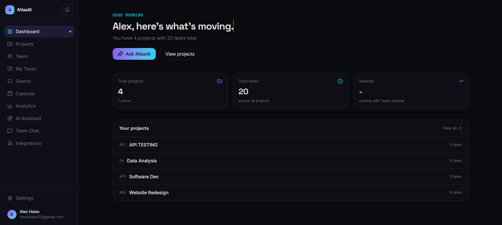

## Features

### Projects and tasks
- Kanban board with drag and drop, optimistic updates and keyboard shortcuts (select a card, press `1-5` to move it between columns)
- Board and table views, plus a task detail modal with comments and a full activity timeline
- Calendar view of everything with a due date, and a cross-project "My Tasks" page
- Quick-add bar: type "Fix login bug urgent tomorrow" and AI turns it into a structured task

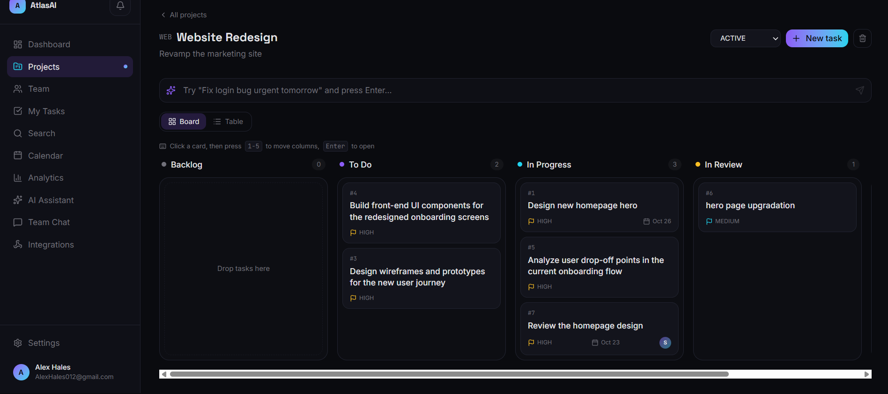
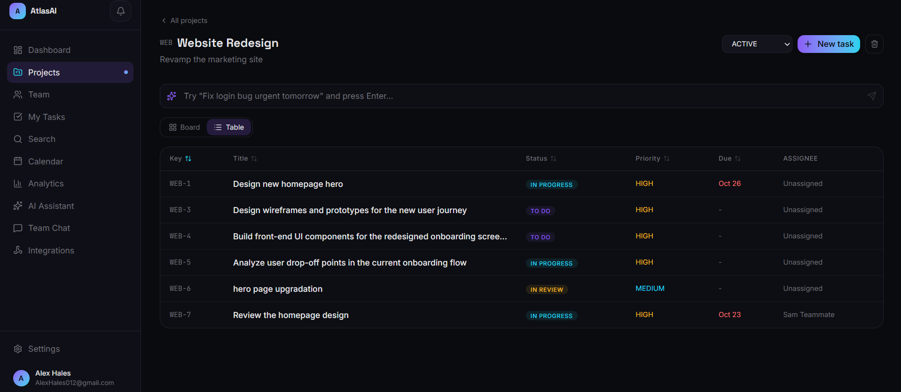
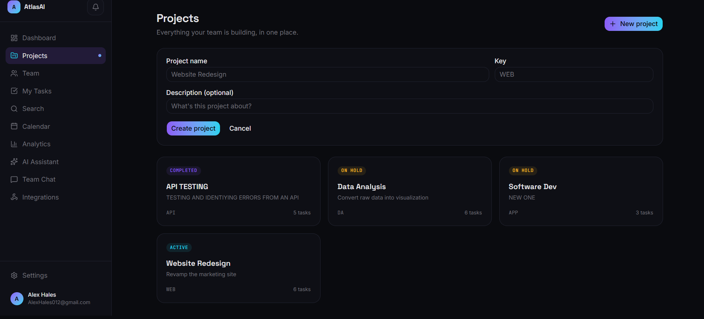
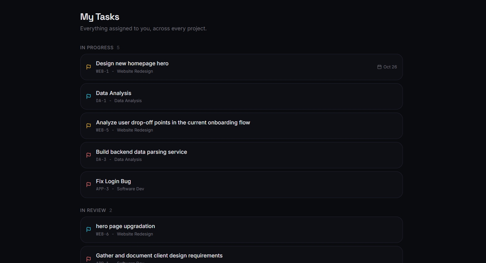
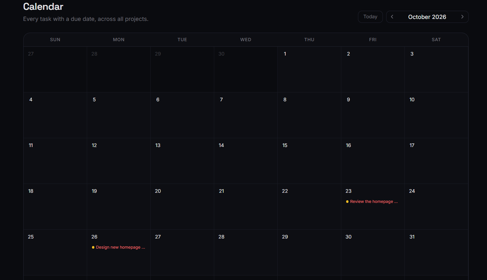

### AI assistant (Google Gemini with function calling)
- Chat with your workspace: "What tasks are overdue?", "Move WEB-12 to Done", "Assign WEB-4 to Sam and comment that it needs review"
- The assistant acts through the same service layer as the UI, so activity logs, notifications and webhooks fire for AI actions too
- Generate a task list from a plain-language goal, and project status summaries
- It cannot delete anything

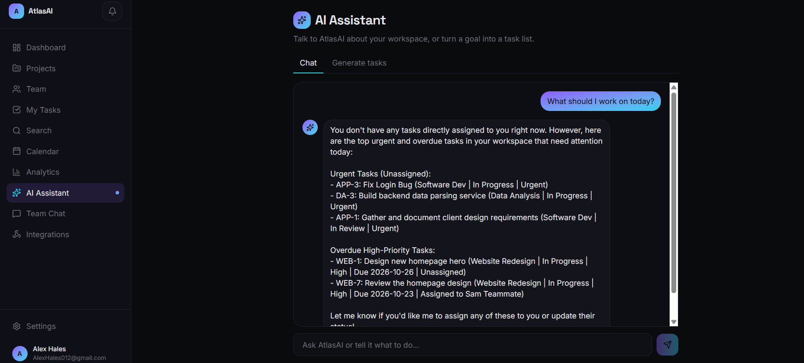

### Collaboration
- Organizations with role-based access (owner, admin, member, viewer)
- Team invitations through shareable links
- Real-time team chat and live presence avatars (Socket.IO)
- Notifications with an unread badge and a synthesized sound cue

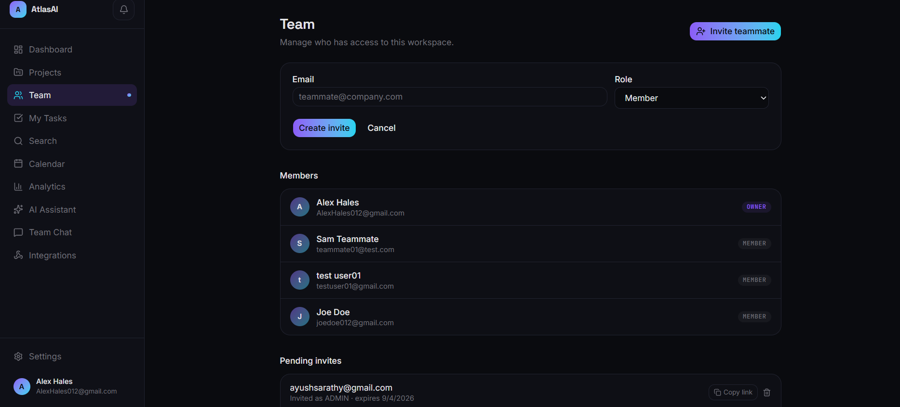
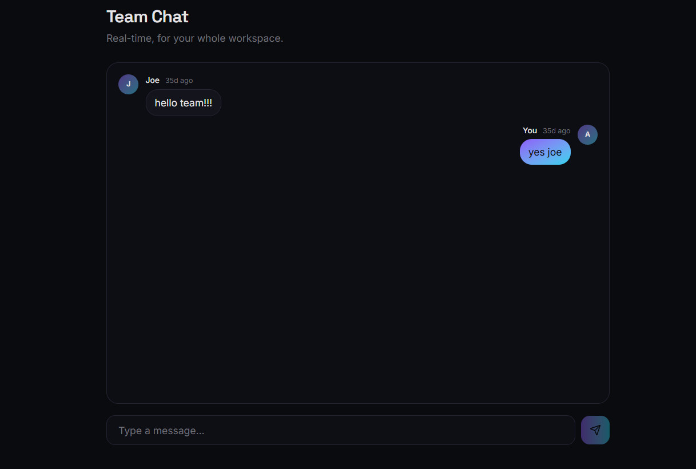

### Insight and tooling
- Analytics dashboard: status and priority breakdowns, a 14-day completion trend and per-project progress
- Command palette (`Ctrl/Cmd + K`) with live search, plus an advanced search page with assignee, priority, status and due-date filters
- Outgoing webhooks for task and project events (Slack, Discord, Zapier or any URL)
- Profile and password settings (changing the password signs out every session)

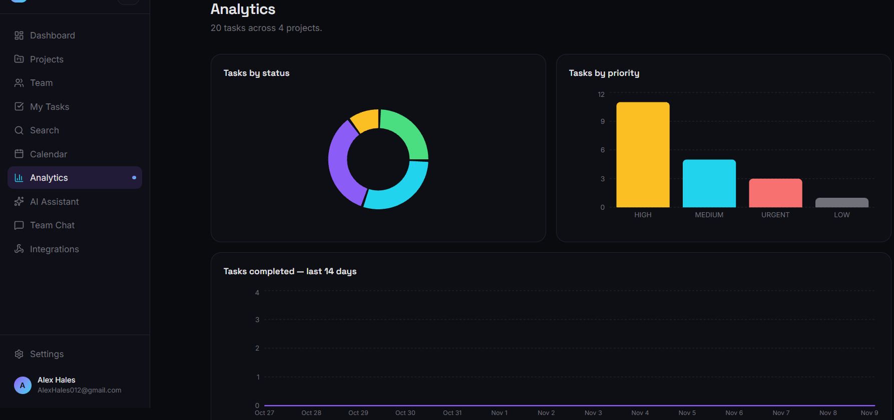
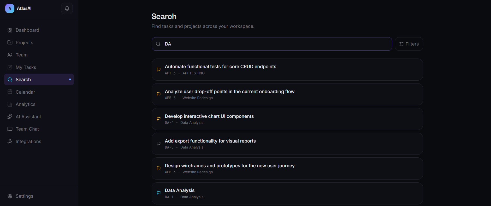
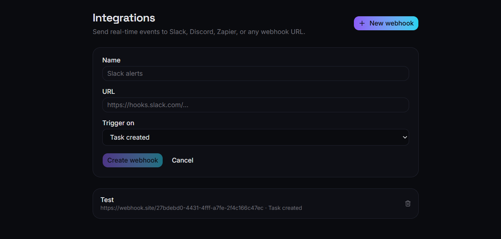
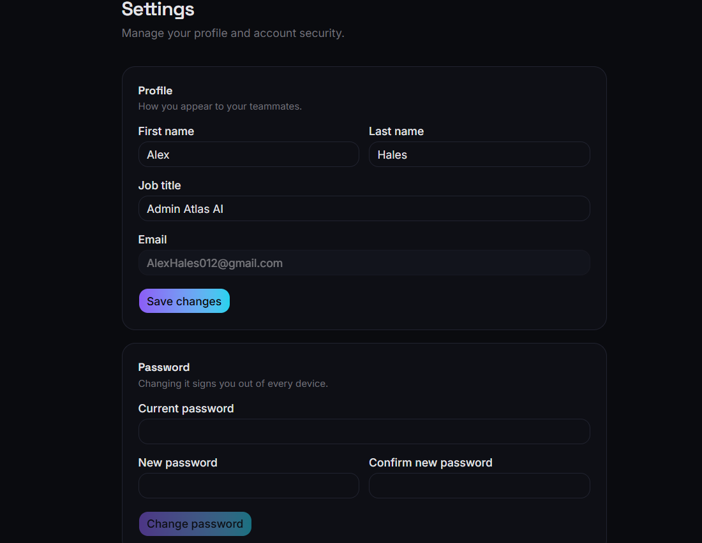

## Architecture

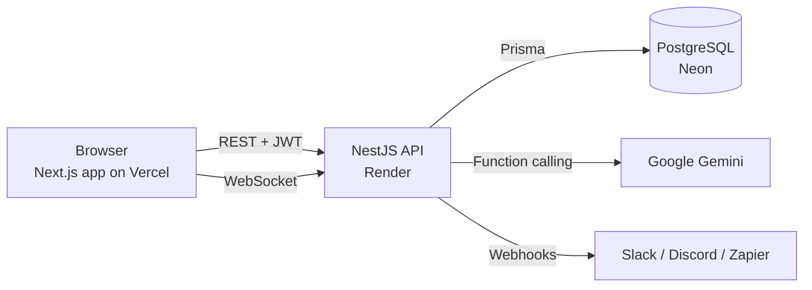

- The API is organised into feature modules (auth, organizations, projects, tasks, notifications, chat, presence, webhooks, AI), each with its own controller, service and DTOs.
- A global JWT guard protects every route by default, and public routes opt out explicitly.
- The AI agent exposes a fixed set of tools to Gemini and runs them through `TasksService`, never directly against the database.
- Refresh tokens are stored hashed and rotated on use, and changing a password revokes all of them.

## Tech stack

| Layer | Technologies |
|---|---|
| Frontend | Next.js 16, React, TypeScript, Tailwind CSS v4, shadcn/ui, TanStack Query, Zustand, Framer Motion, Recharts, dnd-kit, cmdk |
| Backend | NestJS 11, Prisma 7, PostgreSQL, Socket.IO, JWT with rotating refresh tokens, class-validator |
| AI | Google Gemini API (function calling) |
| Infrastructure | Vercel, Render, Neon, Docker (local database), GitHub |

## Run it locally

Requirements: Node 22+ and Docker Desktop.

```bash
git clone https://github.com/Ayush05092004/AtlasAI.git
cd AtlasAI

# Database
docker compose up -d

# Backend (http://localhost:4000)
cd backend
cp .env.example .env        # then fill in the values, including GEMINI_API_KEY
npm install
npx prisma migrate dev
npm run start:dev

# Frontend (http://localhost:3000), in a second terminal
cd frontend
npm install
npm run dev
```

Backend environment variables are documented in `backend/.env.example`. For a deployed frontend, set `NEXT_PUBLIC_API_URL` to the backend URL, and set `FRONTEND_URL` on the backend to the frontend URL.

## Known limitations

- Chat and presence events trust the user ID sent by the client. Authenticating the WebSocket handshake with the JWT is the next hardening step.
- Invitations are shareable links, not emails.
- There are no file attachments yet.

## Author

Built by [Ayush](https://github.com/Ayush05092004).